<div align="center">

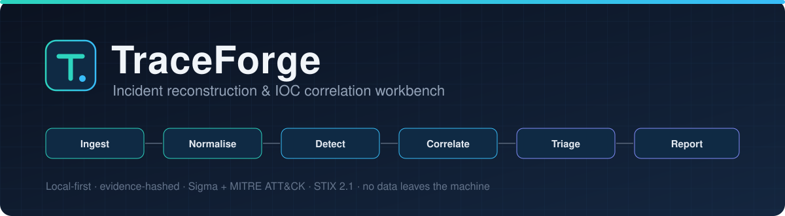

<br>

[](https://github.com/YOUR-USERNAME/traceforge/actions/workflows/ci.yml)
[](https://github.com/YOUR-USERNAME/traceforge/actions/workflows/codeql.yml)


[](LICENSE)

**[Quick start](#-quick-start)** &nbsp;·&nbsp; **[Case study](#-case-study-friday-night-intrusion)** &nbsp;·&nbsp; **[Detection coverage](#-detection-coverage)** &nbsp;·&nbsp; **[CI/CD gate](#-cicd-gate)** &nbsp;·&nbsp; **[Security model](#-security-of-the-tool-itself)** &nbsp;·&nbsp; **[Docs](#-documentation)**

</div>

---

## Overview

Security exports rarely arrive in one format: VPN, firewall, web and endpoint logs each use their own fields and clocks.
**TraceForge** loads them into one workspace, normalises every record to UTC and a canonical schema, runs explainable
detections, links related findings into **incidents with a kill-chain timeline**, and exports an **evidence-linked report**.
It runs entirely on the analyst's machine: no telemetry, no cloud calls, no data leaves the computer.

<table>
<tr>
<td align="center" width="25%"><b>7+</b><br><sub>input formats<br>CSV, JSON, NDJSON, text, Windows XML / Sysmon, Zeek, CloudTrail, zip/gz</sub></td>
<td align="center" width="25%"><b>17</b><br><sub>built-in rules, ATT&amp;CK-mapped, incl. IOC match<br>plus a validated Sigma subset</sub></td>
<td align="center" width="25%"><b>7</b><br><sub>outputs<br>PDF, Markdown, JSON, CSV, STIX 2.1, ATT&amp;CK layer, encrypted case</sub></td>
<td align="center" width="25%"><b>SHA-256</b><br><sub>evidence vault<br>hash-chained audit log</sub></td>
</tr>
</table>

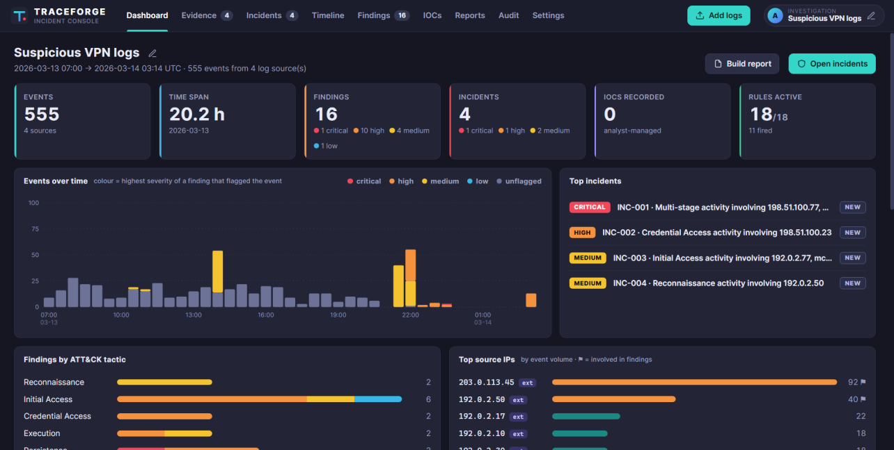

## ▍ How it works

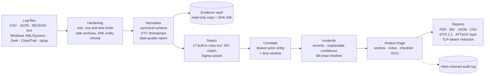

<details>
<summary><b>System context, layered architecture and data flow</b></summary>
<br>

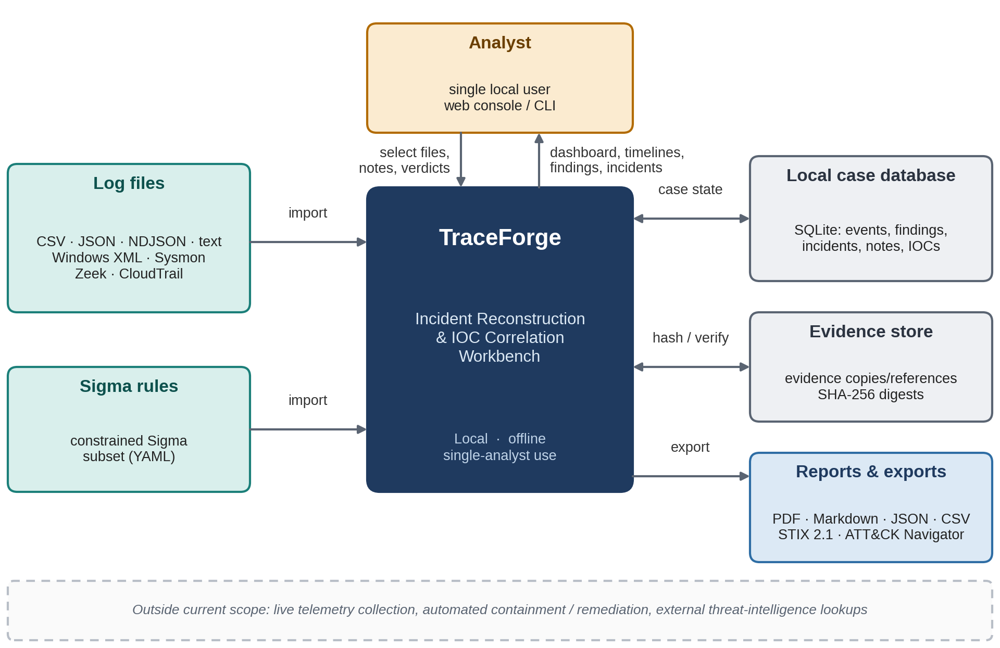
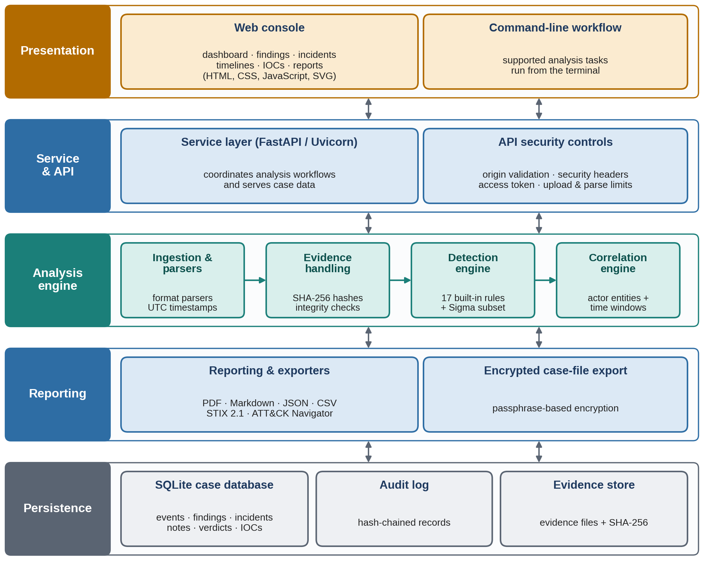
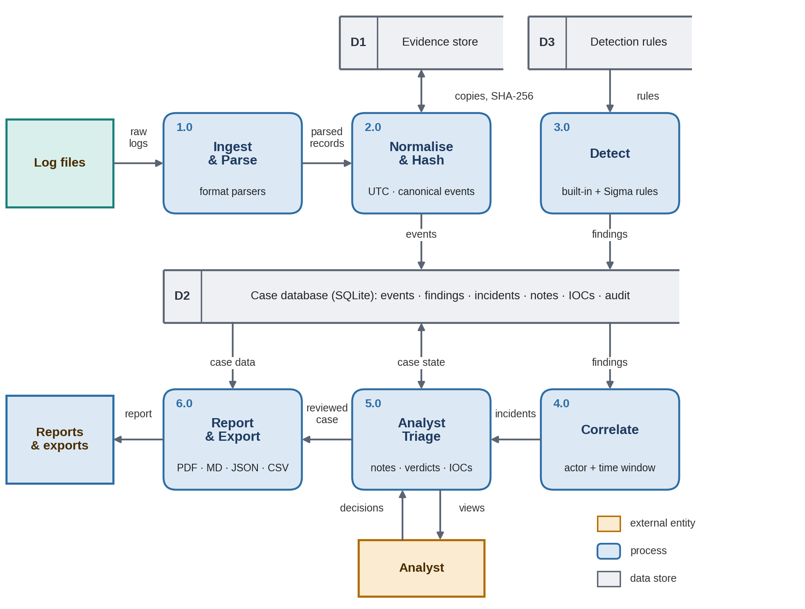
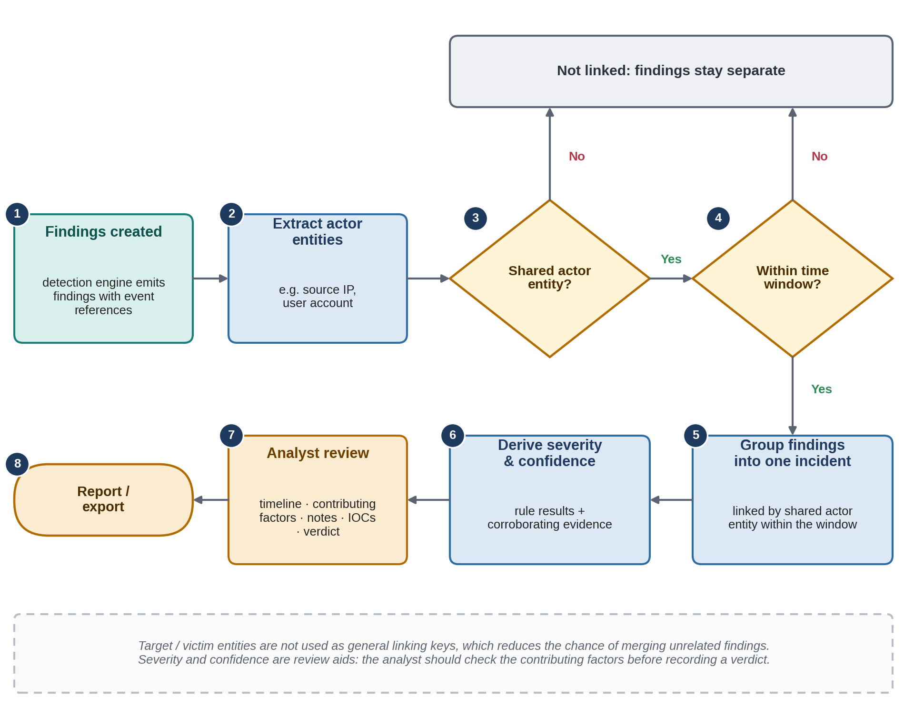

Module-level detail is in [docs/ARCHITECTURE.md](docs/ARCHITECTURE.md).
</details>

## ▍ Quick start

```bash
pip install .                 # Python 3.11+
traceforge serve              # opens http://127.0.0.1:8000, then click "Load sample data"
```

<details>
<summary><b>Windows, Docker and development install</b></summary>

```powershell
py -m venv .venv; .venv\Scripts\Activate.ps1; pip install .; traceforge serve
```

```bash
# Docker (hardened, non-root, read-only filesystem, published on localhost only)
export TRACEFORGE_TOKEN=$(python -c "import secrets; print(secrets.token_urlsafe(32))")
docker compose up --build

# Development
pip install -r requirements-dev.txt && pip install -e . --no-deps
make check                    # ruff + pytest (coverage gate) + bandit + pip-audit
```
</details>

**Headless analysis**

```bash
traceforge analyze logs/* --tlp TLP:GREEN --pdf report.pdf --md report.md --stix iocs.json --attack-layer layer.json
```

**Practice with every scenario**: `traceforge analyze lab_data/01_all_scenarios.csv --ioc-file lab_data/iocs.txt --sigma lab_data/sigma_rules` triggers all 17 built-in rules and Sigma (details in [lab_data/README.md](lab_data/README.md)).

## ▍ Case study: Friday-night intrusion

The bundled synthetic dataset (RFC 5737 addresses, fictional accounts) reconstructs a multi-stage attack across four
sources. Running it headlessly:

```console
$ traceforge analyze traceforge/sample_data/* --tlp TLP:GREEN
555 events | 16 findings | 4 incidents
  INC-001 [critical] confidence=90 Multi-stage activity involving 198.51.100.77, 203.0.113.45, user-14
  INC-002 [high] confidence=30 Credential Access activity involving 198.51.100.23
  INC-003 [medium] confidence=30 Initial Access activity involving 192.0.2.77, user-15
  INC-004 [medium] confidence=30 Reconnaissance activity involving 192.0.2.50
  Redacted for sharing: usernames (13), hostnames (3), internal IP addresses (45). External IP addresses and indicators are unchanged.
```

`INC-001` links web scanning and injection, 22 failed logins followed by a success, a hidden encoded PowerShell command,
a new account added to Administrators, a 72 MB outbound transfer and a cleared audit log. Every step links back to the
exact events behind it. The full walkthrough is in [docs/USE_CASE.md](docs/USE_CASE.md).

<table>
<tr>
<td width="50%">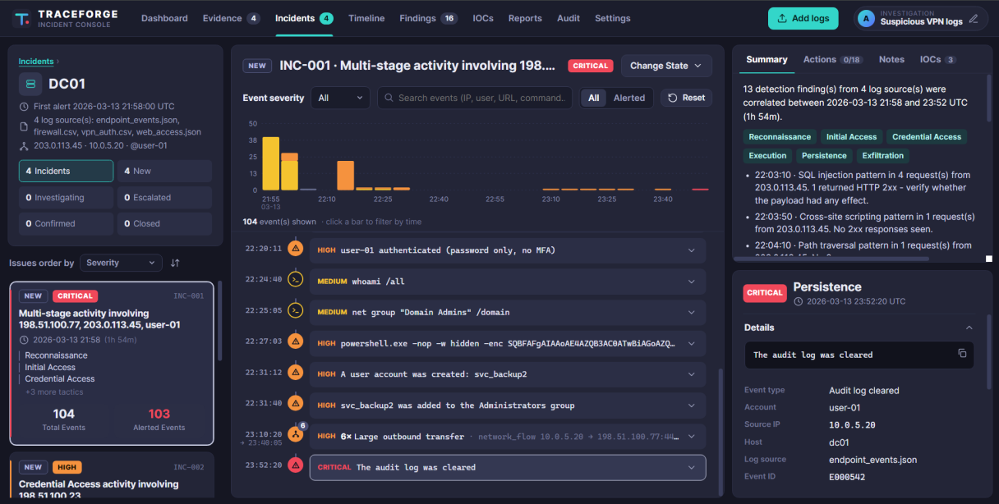<br><sub><b>Incident timeline</b>: severity, kill-chain steps and linked events</sub></td>
<td width="50%">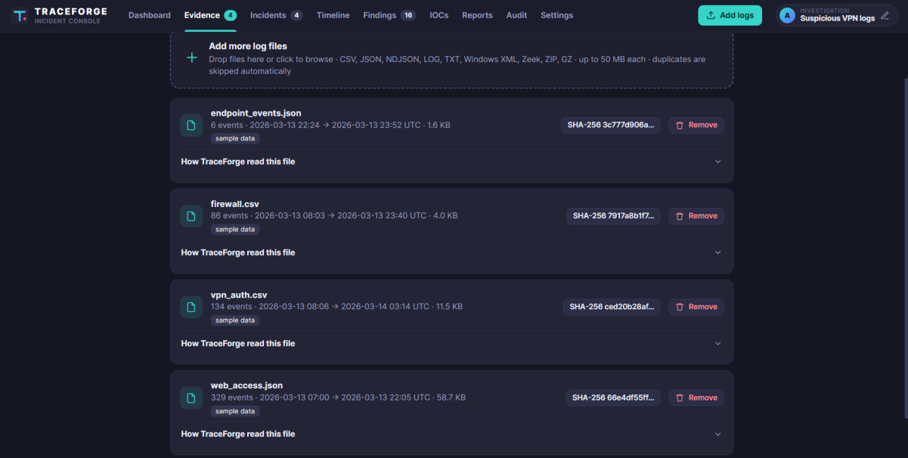<br><sub><b>Evidence &amp; data quality</b>: per-file hashes, counts and parsing notes</sub></td>
</tr>
<tr>
<td width="50%">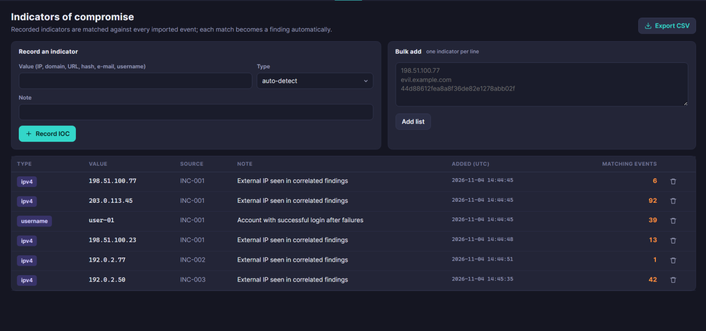<br><sub><b>IOC tracking</b>: every match becomes a finding; export as STIX 2.1</sub></td>
<td width="50%">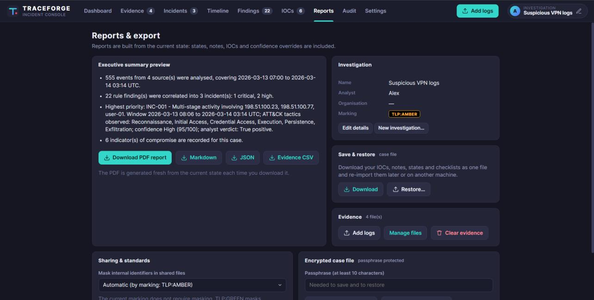<br><sub><b>Reports</b>: PDF, Markdown, JSON, CSV, ATT&amp;CK layer, encrypted case file</sub></td>
</tr>
</table>

## ▍ Detection coverage

| Tactic | Rules | ATT&CK techniques |
|---|---|---|
| Reconnaissance | `port_scan`, `web_scan` | T1046, T1595.002 |
| Initial Access | `multi_ip_login`, `off_hours_login`, `success_after_failures`, `web_attack_payload` | T1078, T1190 |
| Credential Access | `brute_force`, `password_spray`, `mfa_fatigue` | T1110, T1110.003, T1621 |
| Execution | `suspicious_command`, `office_spawns_shell`, `sigma_match` | T1059, T1204.002 |
| Persistence | `persistence_mechanism`, `sensitive_activity` | T1543.003, T1053.005, T1547.001, T1136, T1098, T1070.001 |
| Lateral Movement | `lateral_movement` | T1021 |
| Command and Control | `beaconing` | T1071, T1571 |
| Exfiltration | `large_outbound` | T1048 |
| Threat Intel | `ioc_match` | recorded indicators |

Each rule lists the test that proves it fires and its known false positives in
[docs/DETECTION_RULES.md](docs/DETECTION_RULES.md), which is generated from the code and checked in CI.
Detections are investigative leads for an analyst, not verdicts.

## ▍ CI/CD gate

`--fail-on` turns TraceForge into a pipeline step. Status `0` means clean, `2` means an incident reached the threshold,
and `1` is reserved for errors.

```yaml
- name: Triage exported logs
  run: traceforge analyze exports/* --tlp TLP:AMBER --md triage.md --fail-on high
```

## ▍ Security of the tool itself

TraceForge handles sensitive logs, so it defends itself. Controls and the tests behind each one are listed in
[THREAT_MODEL.md](THREAT_MODEL.md).

| Control | Effect |
|---|---|
| Host / Origin checks (always on) + optional access token | A malicious page or DNS-rebinding site cannot drive the local console |
| Evidence vault + SHA-256 re-checks | Imported files are read-only copies, verified at every start; tampering is flagged |
| Hash-chained audit log | Tamper-evident record of verdicts, notes, IOC changes and exports |
| Upload hardening | Size, row, column and nesting limits, parse-time budget, safe ZIP/gzip, XML entity refusal |
| TLP-driven redaction | TLP:CLEAR / GREEN reports mask usernames, hostnames and internal IPs with collision-free tokens |
| Encrypted case files | AES-256-GCM with scrypt key derivation |
| Supply chain | CodeQL, bandit, pip-audit, Dependabot, hardened non-root Docker image |

Known limits (single analyst, plain HTTP on localhost, unencrypted live database) are stated in the threat model.

## ▍ Engineering quality

| | |
|---|---|
| **Tests** | 201 tests across ingestion, rules, correlation, API, security, redaction, reports, CLI and the scenario pack; 93 % coverage with a 90 % gate |
| **CI** | Ubuntu and Windows, Python 3.11 - 3.13, ruff, bandit, pip-audit, CodeQL, wheel build and install smoke test, Docker build |
| **Reproducibility** | Sample data and rule documentation are generated; CI fails if they drift |
| **Release** | Tag-driven workflow builds the wheel and sdist, with SHA-256 checksums |

```text
traceforge/   application package: ingest, formats, detect, sigma, correlate, evidence, audit, redact, report, server, web/
tests/        pytest suite, one file per area
docs/         user guide, architecture, detection coverage, deployment, use case, sample report
lab_data/     scenario pack: every format and every rule, generated and tested
scripts/      sample-data, rule-doc and scenario-pack generators
.github/      workflows, issue and PR templates, CODEOWNERS, Dependabot
```

## ▍ Roadmap

- [x] Multi-format ingestion, canonical schema, UTC normalisation, data-quality report
- [x] 17 built-in ATT&CK-mapped rules (including IOC matching) and a validated Sigma subset
- [x] Entity and time-window correlation with explainable confidence
- [x] Evidence vault, audit chain, TLP redaction, encrypted case files, STIX 2.1, ATT&CK layer
- [x] Severity gate for CI/CD (`--fail-on`)
- [ ] Native binary EVTX parsing (export to XML first for now)
- [ ] GeoIP and impossible-travel detection
- [ ] Attack-graph visualisation
- [ ] Multi-user roles, TLS and an external database for team deployments

## ▍ Documentation

[Scenario pack](lab_data/README.md) · [Use case](docs/USE_CASE.md) · [User guide](docs/USER_GUIDE.md) · [Architecture](docs/ARCHITECTURE.md) ·
[Detection rules](docs/DETECTION_RULES.md) · [Deployment](docs/DEPLOYMENT.md) · [Threat model](THREAT_MODEL.md) ·
[Security policy](SECURITY.md) · [Changelog](CHANGELOG.md) · [Contributing](CONTRIBUTING.md) ·
[Sample report](docs/sample_report/sample_incident_report.md)

Sample data is synthetic and reproducible (`python scripts/generate_sample_data.py`). Do not commit real production logs,
credentials or customer data.

## License

[MIT](LICENSE)
