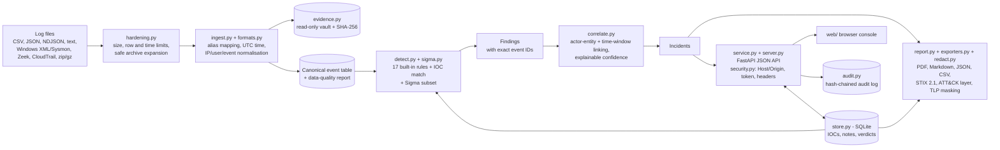

# Architecture

## Modules

| Module | Responsibility |
|---|---|
| `traceforge/ingest.py` | Parse files (JSON, NDJSON, CSV and raw text logs), map columns by alias (including nested JSON), normalise timestamps to UTC, validate IPs, clean usernames, classify event types, count dropped rows, hash files. |
| `traceforge/detect.py` | Rule engine. Each rule returns findings holding the evidence event IDs. |
| `traceforge/correlate.py` | Union-find linking of findings that share an IP, account or host within a gap; severity, ATT&CK ordering, explainable confidence, IOC candidates, remediation. |
| `traceforge/store.py` | SQLite for IOCs, analyst notes and verdicts; JSON case export/import. |
| `traceforge/report.py` | reportlab PDF (cover, executive summary, integrity table, timelines, evidence, IOCs, methodology), Markdown, JSON, CSV-injection-safe export. |
| `traceforge/cli.py` | Headless analysis: `python -m traceforge.cli analyze ...`. |
| `traceforge/service.py` | `Workspace`: owns the loaded evidence, runs detection/correlation, and shapes results for the UI (incident cards, event histograms, timeline lanes, dashboard). Pure Python, unit-testable. |
| `traceforge/server.py` | Thin FastAPI layer: validation, routing, downloads and security headers. |
| `traceforge/web/` | The console: Dashboard, Incidents (three-pane workbench), Timeline, Findings, IOCs, Reports, Settings. Vanilla JS + SVG charts, no CDN or external requests. |
| `run.py` | Starts the server (`python run.py`) and opens the browser. |

## Canonical event schema

`event_id, timestamp (UTC), src_ip, dst_ip, dst_port, user, event_type, host, message, status_code, url, bytes_out, command, source, raw`

Event types: `login_success, login_failure, account_created, group_add, log_cleared, process_exec, web_request, network_flow, firewall_block, firewall_allow`, otherwise a cleaned version of the original value.

## Correlation logic

1. Each finding carries *actor* entities (e.g. `ip:203.0.113.45`, `user:user-01`, `host:dc01`). Targets such as a victim web server are deliberately not used for linking, otherwise unrelated attackers would merge.
2. Findings that share an entity and are within `correlation.max_gap_minutes` are unioned into one incident.
3. Severity is the maximum finding severity, raised to *critical* when three or more ATT&CK tactics appear alongside a high finding.
4. Confidence = 20 baseline + points for independent rules, multiple log sources, tactic progression, evidence of success/impact and IOC matches (capped 5-95). Each factor is displayed and the analyst can override the final value.

## Security considerations

- Log content is untrusted: HTML is escaped before display, CSV exports neutralise formula injection, and PDF text is escaped.
- One running instance holds one analyst's case. State is stored in a local SQLite file (`--db` / `TRACEFORGE_DB`). The server binds to localhost unless you pass `--host`.
- No network calls are made: no GeoIP, no threat-intel APIs, no telemetry.

## Security and persistence modules (v1.1)

| Module | Responsibility |
|---|---|
| `security.py` | Pure-ASGI middleware: Host/Origin checks, token and session cookie, request size cap, security headers |
| `hardening.py` | Limits, safe ZIP/gzip expansion, parse-time budget |
| `evidence.py` | Read-only evidence vault keyed by SHA-256, integrity checks |
| `audit.py` | Hash-chained append-only audit log (SQLite triggers + verification) |
| `redact.py` | TLP-driven masking of identifiers for every export |
| `casecrypt.py` | Passphrase-encrypted case files (AES-256-GCM, scrypt) |
| `formats.py` | Windows/Sysmon XML, Zeek and CloudTrail parsers |
| `sigma.py` | Sigma subset: parsing, safety checks, matching |
| `exporters.py` | STIX 2.1 indicators and ATT&CK Navigator layer |
| `launcher.py` | `traceforge serve`: token generation and safe defaults |

`Workspace` writes an audit entry for every state change and keeps the vault and manifest in step with the loaded evidence. On start-up it re-reads the vault, verifies each file's SHA-256 and excludes any file that fails.
